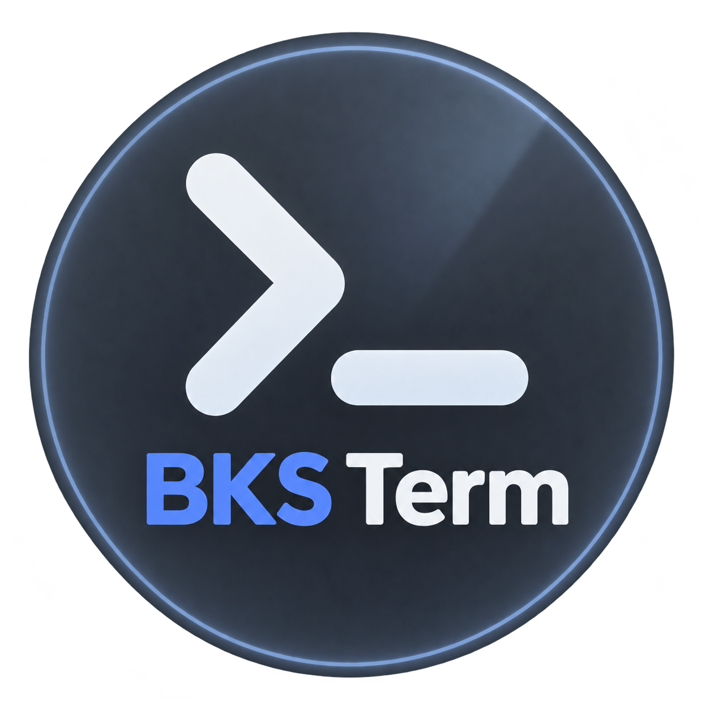
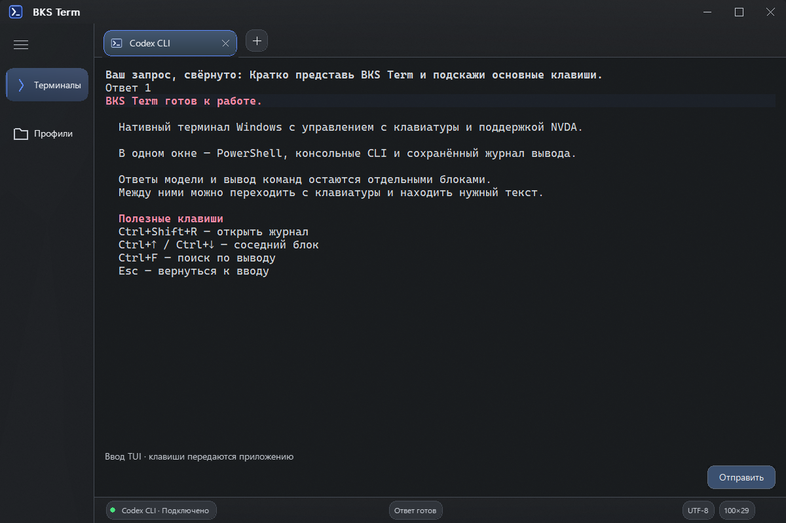

<p align="center">
  
</p>

# BKS Term

Терминал для Windows на Rust с приоритетом работы с NVDA: нативный Win32-интерфейс, PowerShell через ConPTY и навигация по результатам команд.

Текущая версия — **0.4.0-preview.34**, Windows 10/11 x64. Это предварительная
сборка: автотесты и UIA-проверки дополняют ручную проверку с NVDA.
Цвета, редактирование и меню TUI подготовлены к ручной проверке с NVDA.
Концепция и план — в `docs/`, состояние разработки — в `MEMORY.md`,
правила для агентов — в `AGENTS.md`.

В текущей версии доступны оболочки и SSH во вкладках, доступное поле ввода,
чтение и поиск по выводу. Интеграция Codex сохраняет финальные ответы и
результаты служебных команд отдельными блоками, сообщает о ходе работы
и поддерживает Unicode, многострочный ввод и очередь запросов.

## Интерфейс Frosted Glass



Снимок настоящего окна `preview.34` с демонстрационным содержимым.

Оболочка использует тему Frosted Glass: нейтральное серое стекло,
локальные синие акценты и плотное матовое стекло под текстом.
Прозрачность охватывает всё окно, включая вывод и поле команды.
Шапка и нижняя полоса легче, боковая панель и терминал более матовые;
цвет окружения передаётся через системное размытие. Acrylic доступен
в Windows 11 22H2+; Windows 10 и режим без прозрачности используют ту же
палитру с непрозрачным фоном. Высокая контрастность Windows имеет приоритет.
В меню настроек есть «Матовое стекло и прозрачность»; для диагностики можно
запустить процесс с `BKS_TERM_DISABLE_BLUR=1`.

[Паспорт проекта](docs/project-passport.md),
[исходный дизайн-референс](docs/BKS_Term_Design_Spec_and_Reference/BKS_Term_Glass_Design_Spec.md).
Логотипы доступны отдельно: [круглый](docs/bks-term-logo-frosted-circle.png)
и [основной Frosted Glass](docs/bks-term-logo-frosted.png).

[Руководство пользователя](docs/help.md), [ручная приёмка](docs/manual-final.md),
[установка и удаление](docs/release.md), [границы версии](docs/known-limitations.md).
Готовые portable ZIP и Setup EXE после сборки находятся в `target/packages/`.
В распакованном portable запускайте `bks-app.exe`; установка выполняется для
текущего пользователя. При обычном удалении настройки сохраняются.

## Быстрый старт с TUI

1. Откройте PowerShell-вкладку. В нативном поле команды доступны обычное
   редактирование, выделение и журнал результатов.
2. Введите простую команду `kimi`, `codex`, `claude`, `gemini` или `opencode` без аргументов:
   ввод автоматически передаётся инструменту. После возврата приглашения
   интегрированной оболочки восстанавливается поле команды.
3. В TUI остаётся то же нижнее поле. Оно отражает ввод приложения;
   перенесённое поле и рамка исключаются из верхнего вывода. Клавиши,
   слеш-команды и автодополнение обрабатывает само приложение.
4. Подсказки появляются рядом с полем. Стрелки, Tab, Enter и Esc идут
   приложению; список отражает подтверждённый выбор. Ctrl+Shift+Space
   переводит фокус в вывод и обратно, Esc возвращает из чтения к вводу.

Shift+стрелки выделяют текст общего поля для чтения/копирования. В верхней
области доступны обычное чтение, выделение, цвета и оформление NVDA.
Ctrl+Shift+L читает поле ввода; Ctrl+Shift+R открывает последний ответ либо
вывод последней служебной команды, например `/status` в Codex.
Ctrl+Up/Down переходят между сохранёнными блоками: ответами модели и выводом
служебных команд Codex. Результат `/status` остаётся в общей истории после
дальнейшего набора, следующего ответа и очистки экрана самим CLI.
В неизвестном TUI сохраняется чтение логических строк.
Перед ответом — строка «Ваш запрос, свёрнуто» с началом отправленного текста.
Перейдите к ней стрелками и нажмите Enter или пробел, чтобы раскрыть полный
запрос для чтения и копирования; повторное нажатие сворачивает. Переходы
между ответами по-прежнему ставят каретку на начало ответа.
Ctrl+Shift+D сохраняет обзор полного исходного экрана.

Для распознанного запроса озвучиваются видимые размышления, поиск и выполнение.
В Codex команды `Ran` и их stdout относятся к ходу работы; сохранённый ответ
начинается с финального сообщения модели. При долгой работе после 15 секунд
без новой речи звучит «Работа продолжается», пока на исходном экране подтверждена
работа Codex. Настройка «Вручную», фон и набор текста подавляют напоминания.
«Ответ готов» приходит один раз по подтверждённому завершению; фокус остаётся
на месте. Без достаточных признаков сообщается только «Новый вывод».
В «Профили → Настройки» отдельно включаются звук готовности и автоматическое
чтение полного ответа; по умолчанию оба выключены. Журнал вывода хранится
в памяти вкладки: до 128 блоков и 2 МиБ, очистка — через меню
«Профили». Запрос — до 128 КиБ с явной отметкой при ограничении; состояние
раскрытия сохраняется для каждого сообщения. Прежние сеансы не восстанавливаются.

В «Профили → Профили запуска и оболочка» или «Настройки → Профили и оболочка»
доступны встроенные шаблоны и пользовательские варианты. Дублируйте шаблон,
задайте программу, буквальные аргументы, папку, окружение и адаптер CLI.
Каждый аргумент — отдельный элемент списка; пустые значения и пробелы сохраняются.
Можно выбрать прямой запуск либо поддержанную оболочку, общую оболочку по
умолчанию и отдельную для профиля. Встроенные CLI-профили и новые варианты
после завершения открывают свежую оболочку с сохранением журнала. В настройках
можно вместо этого оставить завершённую вкладку. Изменения
профиля применяются при следующем запуске. Ошибка сохранения возвращает черновик.
Формат profiles.json обновляется до версии 2 при сохранении; старые файлы
читаются, прежние сборки не должны редактировать новый формат.

Профиль OpenCode для подтверждённой версии использует `--standalone` и полный
показ вставки. Shift/Ctrl/Alt+Enter сохраняют модификаторы и при стандартных
настройках добавляют строку; Ctrl+X → Enter ставит запрос в очередь. Запросы,
ответы и их раскрытие сохраняются отдельно. Явные inline-настройки окружения
и пользовательские профили имеют прежний приоритет; глобальная служба и
настройки OpenCode не переписываются. Подробнее — [адаптеры CLI](docs/cli-adapters.md#opencode).

Без явно выбранной оболочки новая вкладка предпочитает установленный PowerShell 7.
Явный профиль Windows PowerShell 5 сохраняется. Если его ExecutionPolicy
блокирует npm-скрипт `opencode.ps1`, используйте `opencode.cmd` или обнаруженный
профиль OpenCode с нативным EXE. Терминал не меняет системную политику.

Общий распознаватель поля и подсказок дополняется отдельными стратегиями
Codex, Claude, OpenCode, Kimi и Gemini. Неизвестный CLI использует универсальный
адаптер; произвольную команду можно связать с нужным адаптером в своём профиле.
Документация и границы проверки версий — в [docs/cli-adapters.md](docs/cli-adapters.md).
Общие компоненты поддерживают
замкнутые рамки, парные линии и панели с левой полосой и фоном. Подсказка
пустого поля не считается введённым текстом. В меню с выделением только
цветом выбор подтверждается после первой стрелки и обновления TUI.
Неоднозначный выбор остаётся в исходном выводе. При неоднозначных
границах весь экран сохраняется в выводе, а общее поле работает как пустой
прямой ввод. Скрытый текст не раскрывается; черновик команды оболочки
сохраняется отдельно. ConPTY объявляет TERM=xterm-256color и COLORTERM=truecolor.

Журнал команд хранит до 512 КиБ текста или 6000 строк; старые строки
удаляются порциями с сохранением позиции чтения в оставшемся тексте.
У экрана терминала отдельная VT-история. Очередь ConPTY ограничена 1 МиБ;
при заполнении чтение ожидает освобождения места.

Отправка команды из поля «Команда» показывает журнал и прокручивает его
к новому результату. При самостоятельном чтении старых строк пассивный вывод
сохраняет выделение и прокрутку. `clear`, `cls` и `Clear-Host` очищают журнал,
когда оболочка передаёт полную очистку экрана; новый prompt остаётся доступен.

Доступные документы VT, прямого ввода и журнала передают цвет текста и фона,
жирность, подчёркивание и инверсию через нативный RichEdit. Переносы строк,
выделение Unicode и копирование согласованы с текстом терминала.
После подтверждённого изменения TUI озвучиваются удаление и перемещение
курсора; нажатие без видимого результата не создаёт сообщение об изменении.

После завершения сессии её вкладка сохраняет вывод и код выхода.
«Профили → Перезапустить в новой вкладке» запускает новую сессию того же
профиля; в режимах автоматической озвучки завершение или ошибка активной
сессии объявляется один раз.

В меню «Профили» доступны создание/редактирование SSH-профилей и защищённый
ввод пароля или ключевой фразы. Профиль содержит адрес/алиас OpenSSH,
необязательные пользователя, порт и путь к ключу. Сохранение профиля не
открывает соединение; для подключения выберите его в меню новой вкладки.
Работает системный `ssh.exe` с обычными проверками host key.

Диалог защищённого ввода отправляет значение непосредственно в указанную
сессию, обходя черновик, блоки команд и файл профилей. Он предназначен для
момента, когда дочерняя программа уже ожидает скрытый ввод: её эхо диалог
не меняет. Подробная справка по всем действиям — F1.

## Возможности

- новые независимые окна с выбором профиля, системный выбор рабочей папки, явная интеграция Проводника;
- нативные настройки клавиш, сохранённые режимы озвучки и поведение последней вкладки;
- недавние профили и начальные папки по явному opt-in, без сохранения команд и автоматического восстановления SSH;
- отдельный opt-in клиент Codex App Server 0.164.0: новый текстовый диалог, stream, Interrupt и разовые command approvals с проверкой запроса;
- настройка озвучивания вывода: только важное (по умолчанию), весь новый вывод или ручное чтение; режим сохраняется;
- обзор любого экрана TUI по `Ctrl+Shift+D`: доступный контекст и нативный список строк; чтение не отправляет клавиши приложению;
- обратная связь после явной навигации учитывает перенос маркера, подсветки/инверсии и видимого курсора; неоднозначные изменения остаются доступны для чтения;
- дополнительный адаптер стартового `Folder access` проверенного Codex CLI **0.164.0**: полный контекст, нативный список и явная отправка с проверкой актуальности; анализ изолирован в отдельном процессе, его отказ сохраняет обычный ввод и чтение;
- фоновое обнаружение Codex, Kimi, Claude, Gemini и OpenCode; обычные TUI-профили и отдельно предлагаемые режимы экранного доступа Claude/Gemini при подтверждённой поддержке;
- запуск PowerShell и выполнение однострочных и многострочных команд;
- тёмный интерфейс с пользовательской иконкой;
- фирменная шапка, вкладки со встроенным закрытием, сворачиваемая боковая панель и строка состояния с размером терминала;
- переход к результату последней команды и навигация между результатами;
- копирование результата блока без самой команды и следующего prompt;
- сохранение позиции прокрутки при поступлении нового вывода.
- независимые вкладки и профили PowerShell/CMD, обнаружение других установленных оболочек;
- VT-экран с курсором, Unicode, очисткой, alternate screen, историей до 10 000 строк и ANSI 16/256/True Color;
- прямой ввод с модификаторами клавиш, поддержкой application cursor и bracketed paste;
- выделение и копирование VT-ячеек, отдельный нативный журнал чтения;
- нативный документ «Экран терминала» для чтения текущего VT и его истории;
- поиск по документу VT без учёта регистра, переход к результату и подсветка совпадений;
- встроенная справка по F1 или через меню «Профили».

В прямом режиме фокус остаётся в общем нижнем поле: оно предоставляет
подтверждённый ввод и каретку, передавая клавиши дочернему приложению. Подтверждённый
видимый набор и устойчивые изменения после явной навигации озвучиваются.
Ctrl+Shift+L читает строку ввода, Ctrl+Shift+R открывает последний ответ или вывод служебной команды,
Ctrl+Shift+Space открывает полный документ чтения;
его закладки и черновик команды независимы от прямого ввода. Графические
кадры собираются в буфере до вывода на экран. Речь NVDA и реальный Kimi
после этого исправления ещё требуют ручной приёмки.

Сочетания в таблице ниже — стандартные. Действующая карта показывается в
начале справки F1; её можно менять в «Профили → Настройки». F1 и
Ctrl+Shift+Space сохраняются для возврата управления из захвата.

При запуске открыты нативные поле «Команда» и журнал чтения. Отдельный нативный документ «Экран терминала» представляет основной VT-экран вместе с историей или только активный альтернативный экран. Он учитывает перезапись текста, объединяет переносы длинных строк и сохраняет явные переводы строк. Чтение документа не меняет прокрутку графического VT-экрана. Доступность с NVDA требует ручной проверки.

При новом выводе и изменении размеров сохраняются выделение и логическое место чтения; позиции основного и альтернативного экранов независимы. Автопрокрутка включается только без выделения, когда каретка находится в конце документа и окно чтения прокручено вниз. Если фрагмент удалён из истории, чтение продолжается у ближайшей сохранившейся строки.

В меню «Профили» (`Ctrl+Shift+P`) выберите «Читать экран терминала» или «Читать журнал команд». Оба источника открываются в том же окне и позволяют выделять и копировать текст обычным `Ctrl+C`. Журнал сохраняет текстовый поток и блоки команд; `Ctrl+Up` / `Ctrl+Down` из документа VT возвращают к этим блокам.

## Горячие клавиши

Кнопка `+` и `Ctrl+Shift+T` открывают выбор профиля. В обычной оболочке работают нативное поле «Команда» и журнал: выделение, удаление и Tab сохраняют прежнее поведение. В отдельном CLI-профиле ввод находится в самой области TUI. `Ctrl+Shift+P` открывает профили и действия; `Ctrl+Shift+I` явно включает управление TUI или освобождает Tab для элементов окна. Шапка поддерживает перетаскивание, двойной щелчок для разворачивания и стандартное системное меню Windows.

Меню оформлены в тёмной палитре терминала и сохраняют нативные роли, имена пунктов, отметку режима, клавиши навигации и выбор по первой букве. Шапка компактная: 36 DIP, логотип 24 DIP, подпись 14 DIP. Вкладки Git Bash, CMD и WSL используют оригинальные цветные иконки установленных приложений. В High Contrast используются системные цвета и стандартное меню Windows.

| Клавиши | Действие |
|---|---|
| `F1` | Снять захват клавиатуры и открыть справку |
| `Ctrl+F` | Открыть поиск по документу VT и его сохранённой истории |
| `F3` / `Shift+F3` при открытом поиске | Следующее / предыдущее совпадение по кругу |
| `Enter` в запросе поиска | Передать фокус уже выбранному совпадению в нативном документе VT; следующий результат — `F3` |
| `Esc` при открытом поиске | Закрыть поиск и вернуть прежний источник и фокус |
| `Ctrl+Shift+Space` | Ввод / выбранный источник чтения; возврат сразу восстанавливает управление |
| `Ctrl+Shift+L` | Прочитать текущую логическую строку ввода без отправки в CLI |
| `Ctrl+Shift+R` | Последний блок вывода TUI; пока новый блок не подтверждён — исходный вывод |
| `Shift+стрелки`, `Shift+Home/End` в TUI | Начать нативное выделение от курсора для чтения и копирования |
| `Ctrl+Shift+Left/Right` | Выделять по словам в документе чтения; из TUI начинает выделение от курсора |
| `Esc` в документе чтения | Вернуться к вводу с работающим Tab |
| `Ctrl+Shift+I` | Включить / выключить захват клавиатуры для приложения в VT |
| `Enter` / `Shift+Enter` в поле команды | Выполнить команду / добавить строку |
| `Tab` / `Shift+Tab` без захвата | Перемещение по элементам окна, включая VT-экран |
| `Tab`, `Esc`, стрелки, `Ctrl+C`, `F2`…`F12` на VT-экране с захватом | Передать клавишу приложению |
| `Alt+Tab` | Переключить программы Windows |
| `Ctrl+Shift+V` / `Shift+Insert` на VT-экране | Вставить текст в PTY |
| `Shift+PageUp` / `Shift+PageDown` в TUI | Начать выделение страницами в документе чтения |
| Колесо мыши на VT | Прокрутить историю VT |
| `Ctrl+Shift+End` на VT-экране | Вернуться к текущему экрану |
| `Ctrl+Shift+T` | Открыть выбор профиля для новой вкладки, как кнопка «+»; Esc — отменить |
| `Ctrl+Shift+P` | Открыть меню профилей и режима ввода |
| `Ctrl+Tab` / `Ctrl+Shift+Tab` | Следующая / предыдущая вкладка |
| `Alt+1`…`Alt+9` | Выбрать вкладку по номеру |
| `Ctrl+Shift+W` | Закрыть активную вкладку с подтверждением |
| `Ctrl+Up` / `Ctrl+Down` | Предыдущий / следующий блок TUI; в оболочке — блок команды |
| `Alt+Up` / `Alt+Down` | Предыдущий / следующий результат |
| `Ctrl+Shift+C` | Копировать выделение VT; без выделения — перейти к последнему блоку и скопировать его. В журнале — копировать текущий блок |
| `Esc` в справке | Закрыть справку и вернуть прежний фокус |

В обычной оболочке Tab обходит элементы окна, а Ctrl+Up/Down переходят по блокам журнала. В TUI обычные стрелки получает приложение; Ctrl+Up/Down открывают соседние блоки ответов и вывода команд, а в неизвестном формате — логические строки. `F1` открывает справку. В документе чтения обычный `Ctrl+C` копирует выделенный текст. `Esc` не закрывает главное окно.

В командном режиме `Ctrl+Shift+Space` переводит фокус из поля команды в документ и обратно; оба поля остаются видимыми. В прямом режиме переключаются управление TUI и выбранный документ. При чтении клавиши не отправляются приложению; Esc или повторное сочетание сразу возвращает ввод и Tab. Черновик команды и состояние чтения сохраняются отдельно для каждой вкладки.

Поиск ищет буквальный Unicode-текст без учёта регистра в сохранённом документе VT, включая историю до 10 000 строк. Из поля команды или журнала Ctrl+F открывает нативный документ VT; из графического VT оставляет его видимым с подсветкой, пока фокус находится в запросе. `Enter` передаёт фокус уже выбранному результату для чтения и копирования; `F3` / `Shift+F3` выбирают следующий / предыдущий. Счётчик показывает «1 из N», при переходе через край — «1 из N — с начала» или «N из N — с конца». Пустой запрос показывает «Введите текст», отсутствие результатов — «Ничего не найдено». Кнопка «Закрыть» действует как Esc. Запрос, текущий результат и открытое состояние независимы для каждой вкладки; закрытие поиска их сохраняет. Если поиск был открыт из документа VT, выбранный результат остаётся местом чтения. Подсветка поиска рисуется отдельно от исходных ANSI-цветов.

После успешного Enter или кнопки «Выполнить» в поле команды приложение однократно сообщает «Команда отправлена» и оставляет фокус в поле. После короткой паузы во вводе запроса оно сообщает актуальный статус: «i из N», статус перехода через край либо «Ничего не найдено». `F3` / `Shift+F3`, кнопки перехода и `Enter` объявляют статус сразу после действия. Ввод запроса и F3 сохраняют фокус; автоматическое объявление не читает команды, приглашения оболочки или весь вывод. Фоновый вывод и служебные обновления окна не повторяют эти объявления. Озвучку исправленного поведения нужно повторно проверить вручную с NVDA.

В журнале оболочки блоки создаются для команд из поля «Команда»; прямой Enter в оболочке пока не создаёт такой блок. История TUI отдельно сохраняет ответы модели и подтверждённые результаты служебных команд Codex. Без shell integration используется граница явной отправки команды, а начало вывода уточняется при совпадении эха. При изменённом эхе или без него блок может включать текст команды или приглашения. На краях истории Ctrl+Up/Down остаются в крайнем блоке. В профилях PowerShell с интегрированным prompt следующий текст ждёт готовности оболочки. В CMD/Git Bash без интеграции команда из поля отправляется сразу.

## Требования

- Windows с ConPTY и PowerShell;
- Rust stable с toolchain `x86_64-pc-windows-msvc`;
- Visual Studio Build Tools и Windows SDK (`rc.exe` нужен для встраивания иконки).

## Сборка и запуск

```powershell
cargo build --release
.\target\release\bks-app.exe
```

## Проверки

```powershell
cargo fmt --all -- --check
cargo clippy --workspace --all-targets -- -D warnings
cargo test --workspace
cargo build --release
```

Интеграционные тесты `bks-pty` запускают реальные сеансы ConPTY. Автотесты не заменяют ручную проверку с NVDA.

`scripts/check-unified-tui.ps1 -PaintIsolation` проверяет изоляцию изображения
VT от нативной прокрутки и доступность текстового провайдера;
`-CliHandoff` — переход shell → CLI → shell без лишних отправок.
Эти проверки используют собственные процессы и не требуют фокуса.
`-TuiSelection` проверяет новые клавиши выделения в отдельном окне и требует
доступного интерактивного рабочего стола; сейчас выполнена только его подготовка.
Реальная речь NVDA, выбор модели и отсутствие воспринимаемых рывков остаются
отдельной ручной приёмкой по [docs/manual-final.md](docs/manual-final.md).

Сценарии проверки VT, режимов, справки и NVDA: [docs/manual-stage5.md](docs/manual-stage5.md).

Проверка документа VT, сохранения места чтения и поиска: [docs/manual-stage6.md](docs/manual-stage6.md).

`scripts/check-accessibility.ps1` проверяет UIA-текст, выделение и клавиатурную навигацию отдельного окна; речь NVDA проверяет пользователь.

`scripts/check-stage6.ps1 -Iteration2` проверяет позиции чтения и переключение источников,
`-Iteration3` — поиск, счётчик, вкладки и клавиши. Скрипт запускает отдельное окно
с изолированными настройками; результаты сохраняет в `target/stage6-check`.

## Структура

- `crates/bks-app` — Win32-окно, обработка вывода, блоки команд и ресурсы приложения;
- `crates/bks-pty` — собственная обёртка ConPTY на `windows-rs`;
- `crates/bks-terminal` — VT-модель, снимки ячеек, история и режимы ввода;
- `docs/decisions` — архитектурные решения.
