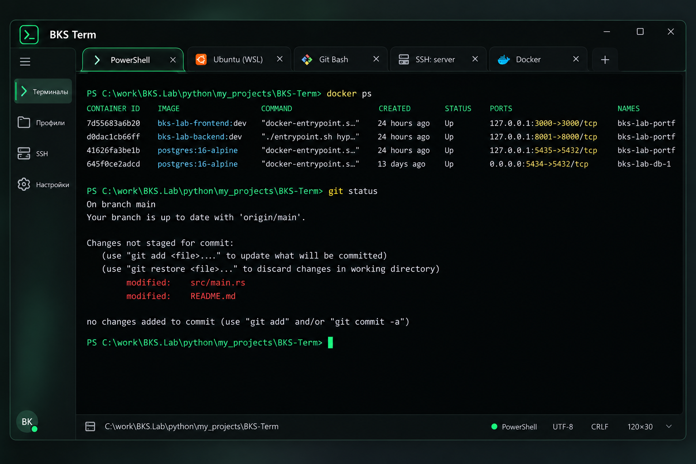

# BKS Term — спецификация визуального интерфейса и редизайна

**Версия документа:** 1.0  
**Язык:** русский  
**Статус:** задание агенту-разработчику  
**Область:** Windows-приложение BKS Term на Rust; визуальный редизайн существующего интерфейса, без переписывания работающей терминальной логики.

> **Основная задача:** преобразовать действующий BKS Term из утилитарного окна с отдельными полями «Вывод» и «Команда» в современную, цельную, быструю и доступную терминальную среду, визуально вдохновлённую аккуратностью Apple и системностью Google Material, **но с собственной узнаваемой тёмно-графитовой и зелёной айдентикой BKS Term**.

## 1. Визуальный эталон



**Файл макета:** `BKS_Term_Design_Reference.png` (лежит рядом с этим Markdown-файлом).

### Как применять эталон

- Считать референсом **композицию, визуальную иерархию, цветовое направление, плотность элементов, ощущение законченного нативного инструмента**.
- **Не** воспринимать изображение как точный технический чертёж: текст, подсветка Docker/Git, размеры и декоративные детали на нём могут быть условными.
- Не создавать «окно внутри окна»: область терминала — основная рабочая поверхность, а не карточка с заголовком «Вывод» и толстой рамкой.
- Не вводить бессмысленные декоративные панели, анимации, плашки «PRO», аватары или псевдофункциональные кнопки. Каждая управляющая кнопка должна выполнять реальное действие.
- Сохранить читаемость интерфейса при маленьких окнах и большом масштабировании Windows.

## 2. Принципы дизайна

1. **Содержимое прежде оформления.** Выводу терминала отдаётся максимально возможная площадь.
2. **Одна поверхность, ясная иерархия.** Верхняя системная панель, ряд вкладок, терминал, компактная строка статуса. Боковая навигация может сворачиваться.
3. **Зелёный — цвет бренда и управления, не глобальный цвет всего вывода.** У CLI сохраняются собственные ANSI-атрибуты.
4. **Современный, спокойный, user-friendly.** Небольшие скругления, тонкие разделители, мягкие состояния hover/focus; без чрезмерного свечения и эффектов «киберпанк».
5. **Клавиатура и NVDA — равноправные способы управления.** Цвет, положение, иконка или анимация не могут быть единственным источником информации.
6. **Никакого ухудшения работающих сценариев.** PowerShell, Git, Docker, SSH, WSL, TUI, горячие клавиши и копирование должны пережить редизайн.
7. **Не подменять функциональность макетом.** Новые элементы появляются по мере подключения их реальных функций.

## 3. Токены цветовой системы

Цвета ниже — **исходные проектные значения для темной темы**; хранить централизованно в теме, не разбрасывать по исходному коду. Верифицировать контраст реального текста и интерактивных состояний.

### 3.1. Поверхности и границы

| Токен | HEX | Применение |
|---|---|---|
| `bg.window` | `#090E0D` | Основной фон окна |
| `bg.terminal` | `#070B0A` | Фон области терминала |
| `bg.sidebar` | `#101917` | Боковая панель |
| `bg.toolbar` | `#101816` | Верхняя панель и строка вкладок |
| `bg.surface` | `#121B19` | Вкладки, статус, выпадающие меню |
| `bg.hover` | `#1B2B26` | Наведение на интерактивный элемент |
| `bg.selected` | `#1A392D` | Выбранный элемент навигации |
| `border.default` | `#273B34` | Ненавязчивые границы |
| `border.subtle` | `#1D2B26` | Разделители |
| `border.active` | `#24E69C` | Активная вкладка, фокус (с поправкой на видимость) |

### 3.2. Текст, акценты и статусы

| Токен | HEX | Применение |
|---|---|---|
| `text.primary` | `#E6EEEB` | Основной текст интерфейса |
| `text.secondary` | `#ACBBB4` | Пояснения, вторичные статусы |
| `text.muted` | `#8D9E96` | Неактивная вторичная подпись (не использовать для важного текста без проверки контраста) |
| `brand.primary` | `#24E69C` | Фирменный зелёный, фокус, активные элементы |
| `brand.hover` | `#49F3B0` | Светлый зелёный на hover |
| `brand.pressed` | `#19BF7E` | Нажатое состояние |
| `brand.onPrimary` | `#04140D` | Текст на ярко-зелёной кнопке |
| `status.success` | `#44D79E` | Успешный статус |
| `status.warning` | `#F5CA65` | Предупреждение |
| `status.error` | `#FF6475` | Ошибка |
| `status.info` | `#65CFFF` | Информация |

**Важно:** приведённые `status.*` используются в интерфейсе приложения и его собственных уведомлениях, **не** для принудительного изменения цветов исходного потока CLI.

### 3.3. Правила использования цвета

- Брендовый зелёный: активная вкладка, выделение в боковой панели, фокус клавиатуры, индикатор состояния, активные действия.
- Бело-серый: основной интерфейс и стандартный текст, если приложение не указало другую окраску.
- Жёлтый, голубой, красный: статусы и **только** те части терминального вывода, для которых окраску выдал процесс либо включена явно выбранная семантическая подсветка в отдельном представлении.
- Цветовая информация всегда дублируется доступным текстом/ролью, когда отражает состояние управления.
- Не устраивать неоновую подсветку вокруг каждой рамки; мягкое свечение допускается лишь как редкий акцент активного состояния и отключается в высококонтрастных режимах.
- Предусмотреть впоследствии светлую и высококонтрастную темы, но на текущем этапе реализовать качественную темную тему.

## 4. Компоновка окна

```text
┌───────────────────────────────────────────────────────────────────────────────────────┐
│ [BKS icon] BKS Term                                        [−] [□] [×]               │
├───────────────┬───────────────────────────────────────────────────────────────────────┤
│               │ [PowerShell ×] [Ubuntu ×] [Git Bash ×] [SSH ×]       [+] [∨]           │
│ [≡]           ├───────────────────────────────────────────────────────────────────────┤
│ Терминалы     │                                                                       │
│ Профили       │                      Н А С Т О Я Щ И Й   Т Е Р М И Н А Л            │
│ SSH           │                      ConPTY + экранный буфер                          │
│ Настройки     │                      ANSI / VT / TUI                                  │
│               │                                                                       │
│               │                                                                       │
├───────────────┼───────────────────────────────────────────────────────────────────────┤
│               │ [Каталог / соединение]                  [Профиль] [UTF-8] [120×30]     │
└───────────────┴───────────────────────────────────────────────────────────────────────┘
```

### 4.1. Заголовок окна

- Логотип, текст «BKS Term», стандартные системные кнопки Windows.
- Высота ориентировочно **44–52 DIP** (зависит от механизма заголовка и системного масштабирования).
- Нативное системное управление окном: Alt+Space, Alt+F4, перемещение/масштабирование, Snap Layouts и активное состояние окна.
- Стандартная зона перетаскивания окна не должна перекрывать интерактивные элементы.

### 4.2. Строка вкладок

- Под заголовком; **не отдельная карточка**.
- Высота ориентировочно **44–48 DIP**.
- Заголовки соответствуют выбранному профилю либо текущему подключению: «PowerShell», «Ubuntu (WSL)», «Git Bash», «SSH: prod-01».
- Текущая вкладка: отчётливая граница/подчёркивание зелёным + выделенный фон; остальные — нейтральные.
- Иконка при наличии, текстовое имя, кнопка закрытия; контролы добавления вкладки и выбора профиля.
- Вкладки должны поддерживать переполнение, скролл списка и управление с клавиатуры.
- Не делать цвет вкладки единственным признаком активности.
- Закрытие вкладки с работающим процессом — явная политика подтверждения, определённая в требованиях к сессиям; сам редизайн не должен завершать сессии.

### 4.3. Боковая панель

- В развёрнутом состоянии ориентир **152–176 DIP**; в компактном **48–56 DIP**.
- Разделы: «Терминалы», «Профили», «SSH», «Настройки»; только если функции действительно реализованы.
- Один понятный механизм сворачивания; по умолчанию можно выбрать компактное представление или сохранить состояние между запусками.
- Иконки — дополнение к текстовым подписям, не замена доступным именам.
- Не отнимать у терминала ширину при небольших размерах окна: при узком окне автоматически сворачивать боковую панель или скрывать её по решению пользователя.

### 4.4. Основная область терминала

- Занимает **всё оставшееся пространство** между вкладками и нижней строкой статуса.
- Убрать самостоятельный заголовок «Вывод» и тяжёлую рамку вокруг него.
- Терминальная сетка рендерится прямо на своей поверхности `bg.terminal`.
- Отступы от края ориентировочно **12–16 DIP**, но должны согласовываться с геометрией моноширинных ячеек.
- Поддержать корректный ресайз сетки и уведомление PTY об изменении числа строк/столбцов.
- Вертикальная прокрутка и история — функциональны, без нарушения интерактивных приложений.
- Для первой версии не добавлять снизу отдельную строку ввода поверх терминала, если уже реализован полноценный интерактивный ввод. **Если нынешняя архитектура использует отдельное поле «Команда», его замена на прямой ввод — отдельная функциональная задача; не удалять поле до готовности PTY-ввода и регрессионной проверки.**

### 4.5. Строка состояния

- Высота ориентировочно **32–40 DIP**, тонкий верхний разделитель.
- Слева текущий каталог или удалённый хост (по достоверным данным; если неизвестны — не придумывать).
- Справа профиль/соединение, кодировка, размеры терминала в колонках × строках.
- Отображать только реальные данные и только действующие действия.
- Статусы соединений не сводить исключительно к красной/зелёной точке: должны быть доступны «Подключено», «Переподключение», «Отключено».

## 5. Типографика и расстояния

### Шрифты

- Интерфейс: **Segoe UI Variable**, запасной **Segoe UI** и системный шрифт Windows.
- Вывод терминала: **Cascadia Mono** или **Cascadia Code** при наличии; запасной доступный моноширинный шрифт. Шрифты не распространять с приложением без проверки лицензии.
- Терминальная область — регулярный моноширинный шрифт с ясным различием `0/O`, `1/l/I`, `-/_`, скобок и кавычек.
- Пользователь должен настраивать шрифт и размер независимо от системного масштаба.

### Размеры — стартовые ориентиры

| Элемент | Размер |
|---|---|
| Основной интерфейс | 13–14 DIP |
| Названия вкладок | 13–14 DIP |
| Вывод терминала | 14–16 DIP / настройка пользователя |
| Межстрочный интервал терминала | В соответствии с метриками ячеек и настройкой |
| Стандартные отступы | Сетка 4 DIP, преимущественно 8/12/16 |
| Скругления | 6–10 DIP для элементов, 10–14 DIP для окна (при поддержке ОС) |
| Минимальная цель клика | Ориентир 32×32 DIP, для важного действия предпочтительно 40×40 |

**DIP не равен физическому пикселю при масштабировании.** Не закреплять геометрию исходя из одного DPI или скриншота.

## 6. Цвета самого терминального вывода: обязательный технический контракт

### 6.1. Источник истины — ANSI/VT

Последовательность: `ConPTY stream → VT/ANSI parser → экранные ячейки с атрибутами → renderer`.

- Поддерживать SGR: `0` (сброс), `1` (яркость/жирность по правилам реализации), `2`, `3`, `4`, `7`, `8`, `9` при поддержке; выбор цвета текста и фона; стандартные и bright ANSI-цвета; 256-цветную палитру; True Color 24-bit.
- Сохранять **и цвет переднего плана, и фон**. Некоторые TUI используют фон выделения, инверсию и оформление курсора.
- Когда приложение не задаёт цвет, использовать токены темы терминала (`terminal.defaultFg` и `terminal.defaultBg`), а не брендовый зелёный по умолчанию.
- При смене темы меняется палитра **значений по умолчанию и стандартных ANSI-индексов**; явно переданные RGB-цвета процесса не перекрашивать.
- Поддерживать корректное состояние стиля между порциями байтового потока.
- Не анализировать слова `error`, `success`, `docker`, `modified`, названия портов и пути, чтобы **молча** перекрасить исходный терминальный буфер. Макет содержит иллюстративную подсветку; она не означает, что Docker/Git обязательно выдают такие цвета.
- Если нужна интеллектуальная подсветка, делать её отдельным opt-in слоем доступного журнала либо использовать возможности конкретной оболочки; не менять VT-семантику TUI.

### 6.2. Начальная палитра ANSI (рекомендованная, настраиваемая)

| ANSI | HEX |
|---|---|
| black | `#101715` |
| red | `#D85A65` |
| green | `#36C992` |
| yellow | `#DDBB67` |
| blue | `#6B9FDB` |
| magenta | `#C18BDD` |
| cyan | `#62BDD0` |
| white | `#D6E1DC` |
| bright black | `#71827A` |
| bright red | `#FF6475` |
| bright green | `#51E7AB` |
| bright yellow | `#F5CA65` |
| bright blue | `#82B8F5` |
| bright magenta | `#D7ACFF` |
| bright cyan | `#80DAED` |
| bright white | `#F7FAF8` |

`terminal.defaultFg = #E6EEEB`  
`terminal.defaultBg = #070B0A`  
`terminal.cursor = #24E69C`  
`terminal.selectionBg = #255744` (проверить читаемость инвертированного и выделенного текста).

### 6.3. Важный пример

Команда `docker ps` часто выдаёт нераскрашенную таблицу. Её нельзя автоматически представлять в тех же разноцветных колонках, что на иллюстрации, если Docker не передал такую окраску. При этом цветовые токены оболочки, Git, `ls --color` и TUI корректно отображаются **ровно по их сигналам**, включая оттенки, заданные 24-битным RGB.

## 7. Доступность: NVDA и Windows UI Automation

**Критерий успеха:** новая оболочка визуально лучше прежней и при этом не заставляет пользователя прибегать к объектной навигации для обычных вкладок и меню.

- Вкладки: системная роль `Tab`/`TabItem` либо эквивалентные корректные UIA-паттерны, имя, выбранное состояние, положение в наборе, правильный фокус.
- Боковая панель и выбор профилей: корректные роли кнопок/списков, доступные названия и изменения состояния.
- Смена активной вкладки: NVDA объявляет **имя новой вкладки**, а фокус возвращается в связанную терминальную сессию по предсказуемому правилу.
- При сворачивании панели фокус не должен исчезать; доступная команда открытия всегда остаётся.
- Не использовать безостановочные UIA/live-region уведомления на каждую перерисовку терминала.
- Сохранить существующий доступный журнал / вывод и принцип раздельных режимов чтения и интерактивного ввода.
- Не менять команды NVDA и не перехватывать вслепую Ctrl, Alt, Tab, стрелки и Escape в активном TUI.
- Выделение, предупреждения, статусы SSH должны иметь нецветовое представление.
- Тестировать Windows scaling 100%, 150%, 200%, крупный шрифт, keyboard only, видимый фокус, High Contrast / Contrast Themes и Reduced Motion.
- **Снижение визуальных эффектов** при системных настройках; анимации не должны задерживать клавиатурное взаимодействие.

## 8. Поведение вкладок и окон

- Каждая вкладка = независимый терминальный сеанс, отдельный PTY-процесс, экранный буфер, история, доступное представление.
- Закрытие/скрытие другой вкладки не меняет её состояние и не останавливает выполняемую программу.
- Новая вкладка: профиль по умолчанию или выбранный из меню.
- Новое окно: отдельное окно с собственной группой вкладок, если это поддержано слоем сессий.
- Навигация должна соответствовать привычным Windows Terminal-паттернам, но конфликтующие с NVDA сочетания должны быть переназначаемы и проверены пользователем.
- Профили и SSH-подключения — фактические, сохранённые; иконки и статусы на макете не означают дополнительную регистрацию или сторонние службы.

## 9. Реализация на Rust и границы работы агента

### 9.1. Не менять работающий стек без необходимости

Перед началом прочитать репозиторий, `Cargo.toml`, архитектуру UI, ConPTY, хранилище сессий, реализацию терминального буфера и доступности. **Не переписывать приложение под Electron, React, WebView, Qt или другой framework только ради внешнего вида.** Использовать выбранный в репозитории Windows-native UI/rendering stack.

### 9.2. Разделить дизайн-токены и терминальную палитру

Рекомендуемые модули/ответственности (конкретные имена согласовать с реальным проектом):

- `ThemeTokens` — поверхности, текст, границы, акцент, состояния.
- `AnsiPalette` — отображение 16/256 цветов и RGB там, где это необходимо.
- `WindowShell` — заголовок, панели и строки статуса.
- `TabStrip` — визуализация сессий с доступным UIA.
- `Sidebar` — навигация по разделам приложения.
- `TerminalView` — вывод терминального ядра без обёртки-карточки.
- `AccessibilityBridge` — роли, состояния, уведомления NVDA.

Состояние вкладок получать из действующего `SessionManager`, а профили — из `ProfileManager` (или их реальных аналогов). Не создавать фиктивные источники данных исключительно для рисования макета.

## 10. План работы агента короткими итерациями

**Общее правило:** после каждого шага собрать рабочий `.exe`, предоставить краткий отчёт и список проверок для NVDA. Не выполнять следующий этап, пока пользователь не протестирует текущий и не даст обратную связь.

### Итерация 0 — аудит текущей реализации

- Зафиксировать используемые библиотеки/модули, окна, вкладки, терминальный рендер, PTY и UIA.
- Снять скриншот «до», проверить сборку, сохранить работоспособный коммит.
- Определить, есть ли прямой ввод в PTY или отдельное поле команды; описать риски миграции.
- Никаких изменений функциональности.

### Итерация 1 — токены и новая оболочка окна

- Внедрить тёмную палитру и общую типографику.
- Обновить заголовок, аккуратные границы, основной фон и панель статуса.
- Сохранить исходную доступность, системные сочетания клавиш и управление окном.

**Приёмка:** окно запускается, не теряет фокус, контент хорошо читается, масштабирование не ломает верстку.

### Итерация 2 — вкладки и активное состояние

- Применить новый дизайн к настоящим вкладкам, создать адекватный overflow и кнопку создания сессии.
- Переход между вкладками, переключение профиля, корректная озвучка NVDA.

**Приёмка:** несколько вкладок не теряют процессы; можно определить активную вкладку по NVDA без зрения.

### Итерация 3 — боковая навигация

- Добавить/обновить компактную сворачиваемую панель.
- Связать разделы с реальными действиями, убрать любые фальшивые пункты.

**Приёмка:** sidebar не мешает набору команд, клавиатурная навигация последовательна.

### Итерация 4 — терминальная поверхность

- Убрать «окно внутри окна» и лишний заголовок «Вывод».
- Пересчитать отступы, скролл, сетку строк/столбцов при изменении размеров.
- Отдельное поле команды удалять **только** после готовности и проверки прямого интерактивного PTY-ввода.

**Приёмка:** PowerShell, Git, Docker, SSH и полноэкранное TUI отображаются корректно; команды продолжают выполняться.

### Итерация 5 — ANSI-цвета и доступность

- Проверить 16/256/True Color, reset, фон выделения, инверсию, TUI-переходы, альтернативный экран.
- Проверить корректность NVDA и отсутствие речевого спама.

**Приёмка:** цвета процесса сохранены, брендовый зелёный не перекрашивает весь вывод; клавиатура и NVDA работают стабильно.

### Итерация 6 — доводка

- Разные размеры окна, DPI, высококонтрастный режим, Reduced Motion.
- Профили, пустые состояния, ошибки подключения, длинные имена SSH-хостов, десятки вкладок.
- Проверить запуск portable и установленной версии.

## 11. Чек-лист ручного тестирования с NVDA

- [ ] Запуск BKS Term; заголовок окна объявляется корректно.
- [ ] Открыть вкладки PowerShell, Git Bash, Ubuntu, SSH; NVDA читает имена и состояние выбора.
- [ ] Перейти в другую вкладку и вернуться; фокус и незавершённая команда сохраняются.
- [ ] Выполнить `git status`, `docker ps`, длинный вывод и проверить прокрутку/чтение.
- [ ] Проверить команду с ANSI-цветами и True Color.
- [ ] Проверить `ssh` и интерактивное приложение `top`, `htop` или установленный TUI.
- [ ] Свернуть и развернуть боковую панель только с клавиатуры.
- [ ] Уменьшить окно до компактного; терминал остаётся доступен.
- [ ] Переключить масштаб Windows на 150% и 200%; элементы не накладываются.
- [ ] Проверить, что уведомления не засыпают NVDA при обновлении вывода.
- [ ] Проверить диалог закрытия работающей сессии.
- [ ] Проверить подсветку фокуса и навигацию без мыши.

## 12. Что строго запрещено в рамках редизайна

1. Рисовать статический «терминал» вместо использования настоящего ConPTY и терминального буфера.
2. Переносить имеющийся реальный вывод в DOM/текстовое поле ради картинки, если это ломает VT/TUI или взаимодействие с NVDA.
3. Скрывать неисправные функции под красивыми кнопками.
4. Менять цвета процесса только из-за наличия определённых слов в выводе.
5. Добавлять вложенные массивные карточки и дублирующие рамки вокруг терминала.
6. Пытаться в одной итерации одновременно переписать GUI, терминальное ядро, PTY и UIA.
7. Удалять старую функциональность до появления протестированной замены.
8. Оставлять критический статус только в виде точки, цвета или иконки.

## 13. Формат отчёта агента после каждой итерации

```text
Итерация:
Цель:
Что реализовано:
Изменённые файлы:
Какие прежние функции затронуты:
Команда сборки:
Путь к собранному EXE:
Автоматические проверки и результаты:
Ручные сценарии для проверки NVDA (3–6 коротких шагов):
Что пока не сделано:
Известные ограничения и риски:
Вопросы для обратной связи:
```

## 14. Критерий итоговой готовности

BKS Term визуально соответствует зелёно-графитовому референсу; несколько настоящих вкладок живут независимо; активный терминал занимает основную часть окна; ANSI/VT-вывод не искажается; стандартные действия доступны с клавиатуры и NVDA; редизайн не ухудшает запуск команд и TUI; приложение продолжает собираться в Windows `.exe`.

---

**Связанные документы проекта:** исходная концепция BKS Term; план установки и этапов разработки; ТЗ по профилям, вкладкам и SSH. Этот документ дополняет их **только в части визуального интерфейса, цветов, UX и требований к доступности при редизайне**. При расхождениях в поведении реальных сессий приоритет имеют согласованные функциональные спецификации и фактическая работоспособность терминала.
