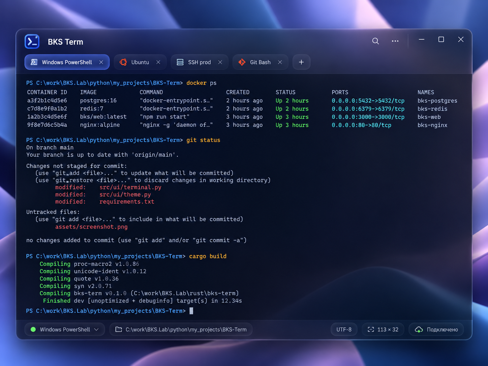

# BKS Term — дизайн-спецификация «Frosted Indigo»

> **Статус:** техническое задание для AI-агента на визуальный редизайн существующего BKS Term.\
> **Приоритет:** максимальное визуальное соответствие приложенному референсу, без переписывания функционального ядра.\
> **Эталон:** `BKS_Term_Visual_Reference.png` (1448 × 1086 пикселей).\
> **Платформа:** Windows; Rust, нативный UI/Windows API, ConPTY, NVDA/UI Automation — сохраняем текущий технологический стек проекта.

## 1. Главная задача и критерий результата

Не «обновить цвета» и не «сделать похоже на macOS». **Воссоздать визуальный язык именно приложенного макета**: очень мягкое тёмно-индиговое матовое стекло, деликатная прозрачность над фоном рабочего стола, плавные градиенты синего и фиолетового, лёгкий объём вкладок, минимальное количество разделителей, чистая типографика и контрастная область терминала.

Дизайн следует воспринимать как **одно цельное приложение**, а не набор вложенных карточек. Главная композиция — большое скруглённое окно; внутри объединённая шапка с названием, действиями и вкладками; под ней — почти сплошная тёмная область вывода; внизу — компактная полупрозрачная полоса состояния с небольшими капсулами.

**Запрещается** возвращать зелёную фирменную оболочку прошлых версий, добавлять боковую панель, превращать главный вывод в отдельную карточку с толстой рамкой, переносить вкладки в отдельный второй «этаж» с большими промежутками или добавлять тяжёлые светящиеся обводки.

### Приоритеты при противоречиях

1. Сохранить функциональность текущего BKS Term и доступность NVDA.
2. Сохранить контраст и корректность терминального текста/ANSI-цветов.
3. Соблюсти композицию, размеры и визуальные отношения референса.
4. Достичь правильного материального эффекта (полупрозрачность/матовость, не просто градиентная заливка).
5. Добавить тонкие переходы и микроэффекты без ущерба скорости.

## 2. Анатомия референса и размеры

Референс — иллюстрация, а не пиксельно точный макет. Ниже — **ориентиры, вычисленные визуально относительно изображения 1448 × 1086**, а не гарантированные измерения исходного UI. Реализация должна масштабироваться на DPI и разные размеры окна.

| Часть | Относительная геометрия/назначение |
|---|---|
| Главное окно | Примерно x=45…1365, y=82…980; ширина около 1320, высота около 900 на изображении |
| Скругление главного окна | Визуально около 22–28 px на референсе; реализовать в DIP с учётом DPI |
| Верхняя объединённая зона | Примерно 130 px общей высоты: заголовок + вкладки; визуально непрерывная стеклянная поверхность |
| Первая строка | Логотип и BKS Term слева; поиск и меню ближе к правой стороне; стандартные Windows-кнопки справа |
| Вторая строка | Горизонтальные вкладки с небольшими интервалами и кнопкой `+` |
| Терминальная область | Начинается непосредственно под вкладками, занимает абсолютное большинство высоты |
| Нижняя строка состояния | Около 50–60 px в пропорциях референса; прозрачная, не контрастная панель с капсулами |
| Внутренние поля | По краям примерно 22–34 px; одинаковая оптическая линия слева в шапке, вкладках и терминале |

При узком окне не уменьшать шрифт терминала автоматически: вкладки должны прокручиваться или сворачиваться в меню; неактивные элементы управления могут скрываться, сохраняя доступность с клавиатуры.

## 3. Цветовая система — не путать фирменную палитру с ANSI

### 3.1. Дизайн-токены интерфейса

Цвета ниже — **стартовые инженерные аппроксимации** к PNG. Для получения окончательного результата агент должен выполнить визуальное сравнение скриншота работающего приложения с эталоном и скорректировать токены. Нельзя представлять значения как исходные авторские параметры изображения.

| Токен | HEX / значение | Применение |
|---|---|---|
| `canvas.base` | `#0B1029` | Фолбэк для приложения без прозрачности |
| `window.tint.top` | `#25345B` | Верхнее стекло, индиговая основа |
| `window.tint.mid` | `#1B2547` | Средняя зона шапки |
| `window.tint.bottom` | `#151C37` | Нижняя полоса |
| `terminal.background` | `#0A1025` | Читаемая непрозрачная или почти непрозрачная поверхность терминала |
| `terminal.background.alt` | `#0E142C` | Едва заметная глубина в больших областях |
| `tab.active` | `#30499A` | Активная вкладка: голубовато-индиговое стекло |
| `tab.inactive` | `#263359` | Неактивная вкладка, значительно спокойнее активной |
| `accent.blue` | `#5E8CFF` | Управляющие акценты и локальный фокус |
| `accent.violet` | `#8372D9` | Мягкие дополнительные отблески, не основной текст |
| `text.primary` | `#F1F3FF` | Заголовки, основной UI текст |
| `text.secondary` | `#B7C1DC` | Неактивные элементы, описание состояния |
| `text.muted` | `#8793B5` | Подписи и второстепенные сведения |
| `border.soft` | `#7586B8` с прозрачностью 12–20% | Тонкие границы стеклянных контролов |
| `status.connected` | `#49E47E` | Малые статусные точки — это не фирменный цвет UI |
| `focus.ring` | `#99C4FF` | Контрастная клавиатурная рамка фокуса |

**Не заливать большую площадь ярким фиолетовым или голубым.** Они используются как спектральный подтон мягкого стекла; контент в центре остаётся визуально спокойным.

### 3.2. Градиенты

- Верхняя полоса: холодный индиго слева, чуть более фиолетовая полупрозрачная тень справа. Пример: linear-gradient `#243457 → #2A315A → #262B4D` с низкой насыщенностью и прозрачностью, применённый поверх backdrop.
- Низ: более глубокий navy, местами слабый лавандово-синий световой рефлекс.
- Терминальный вывод: **практически ровная тёмная поверхность**, допустим едва заметный тональный переход; ни заметных диагоналей, ни ярких бликов за строками текста.
- Подсветка активной вкладки: мягкий внутренний верхний свет, тонкий лавандово-голубой край, без неоновой рамки.

### 3.3. Цвета вывода программы

**Никогда не перекрашивать текст терминала по словам или типу команды.** ANSI SGR-атрибуты, 16/256 цветов, True Color и пользовательская цветовая схема оболочки должны сохраняться. На референсе для иллюстрации встречаются синий путь, оранжевая команда, зелёный `Up` и красные `modified`, но это **демонстрационная палитра**, не требование искусственно окрашивать `docker`, `git`, `cargo` или PowerShell.

Если программа не задаёт цвет, применять терминальный default foreground `#CFD5E9` и default background `#0A1025`. Палитра ANSI 16 — отдельная настраиваемая тема; ошибка/предупреждение в доступном журнале должны маркироваться смыслом, не одним цветом.

## 4. Материалы: как получить матовое стекло

Главная эстетика макета — **frosted glass**, а не просто полупрозрачный прямоугольник.

- Верхняя зона и нижняя полоса используют реальное системное размытие фона, где доступно, и полупрозрачный индиговый tint поверх него.
- В Windows 11 рассмотреть Windows App SDK/Composition и системный Mica/Acrylic там, где они применимы и совместимы с текущим стеком; проверить соответствующие системные API и условия использования. Mica и Acrylic не идентичны; выбрать материал по результатам пробной сборки.
- В Windows 10 и при отключённой прозрачности — полноценный **непрозрачный фолбэк**, сохраняющий цветовую иерархию; не зависеть от эффектов исключительно Windows 11.
- Не размывать непосредственно текст терминала, курсор, выделение, NVDA-фокус или содержимое подсказок.
- Системные настройки высокой контрастности и отключённой прозрачности должны иметь приоритет над авторской визуальной темой.
- Тонкая внутренняя световая кромка окна допустима; размытая большая тень за окном — допустима; тяжёлое свечение каждого компонента — нет.

**Примечание агенту:** способ реализации backdrop определяется конкретной GUI-библиотекой Rust и Windows API. Не подменять реальную матовость рисованием фиолетового фонового PNG и не обещать «настоящий Acrylic», если эффект не задействован на уровне ОС.

## 5. Шапка: одна поверхность вместо отдельных полос

- Логотип около левого верхнего угла: лаконичный светящийся символ терминала в индигово-голубом квадрате с мягкими скруглениями; оставить существующую узнаваемую форму, при необходимости адаптировать цвета под новую палитру без изменения знака без согласования.
- Справа от логотипа — `BKS Term`, достаточно плотный нейтральный UI-шрифт, светлый цвет.
- Верхняя строка очень спокойная: слева бренд, справа иконки поиска, `…`, далее стандартные Windows-кнопки свернуть/развернуть/закрыть.
- **Кнопки Windows**: справа, с корректными hit-targets, системной логикой double-click, Aero Snap, системным меню, drag-to-move, DPI/resize. Не использовать macOS traffic lights.
- Не добавлять тяжёлый второй заголовок «Терминалы» или breadcrumbs над выводом.

## 6. Вкладки

- Расположены в рамках одной общей верхней стеклянной зоны, непосредственно под названием.
- Форма — компактные скруглённые капсулы/мягкие прямоугольники с радиусом примерно 12–16 DIP.
- Активная вкладка: индигово-синяя заливка, тонкий светлый контур, мягкий объём и слегка более яркий текст. Без жёсткой зелёной линии снизу.
- Неактивные вкладки: близкие к фону, лишь немного светлее его, без резкой белой рамки.
- Внутри: иконка профиля, название (`Windows PowerShell`, `Ubuntu`, `SSH prod`, `Git Bash`), кнопка закрытия. Между текстом и иконками — воздух.
- Справа компактная кнопка `+`. Меню у `+` позволяет выбрать профиль новой вкладки. Щелчок по `+` без меню может открыть профиль по умолчанию.
- При избытке вкладок — горизонтальная прокрутка, overflow-меню с нативной доступной структурой; не уменьшать каждую вкладку до нечитаемого размера.
- Действия: Ctrl+Tab и Ctrl+Shift+Tab, горячие клавиши открытия и закрытия вкладок — сохранить и сделать настраиваемыми; проверять конфликты с NVDA.
- При переключении вкладки возвращать клавиатурный фокус в прежнюю активную область сессии, не терять положение курсора/буфера.

## 7. Центральное пространство: терминал без «окна в окне»

Это самое принципиальное композиционное изменение. Под вкладками начинается **единый терминальный холст**. Не нужно отдельного заголовка «Вывод» и большой декоративной панели вокруг консоли.

- Внутренний горизонтальный отступ примерно 28–34 DIP на крупном окне, вертикальный — примерно 16–22 DIP.
- Моноширинный шрифт: начать с `Cascadia Mono` или `JetBrains Mono` (если установлен или легально поставляется), fallback — `Consolas`; размер обычно 12–14 pt, пользовательский масштаб через Ctrl+плюс/минус.
- Межстрочный интервал удобный, но без чрезмерной разреженности; линии вывода выравниваются по сетке символов, включая CJK/Unicode и псевдографику.
- Сохранить прокрутку, выделение, копирование и позицию курсора; горизонтальная полоса прокрутки по умолчанию не нужна при нормальной обработке переноса/размера терминала.
- Фоновое выделение и selection должны быть хорошо видны, но не перекрывать символы.
- Ввод осуществляется непосредственно через ConPTY, когда это поддерживает текущая архитектура. **Существующее отдельное поле команд не удалять слепо:** до завершения полноценного интерактивного ввода оставить его как переключаемый доступный режим, затем убрать из основного визуального сценария.
- Нельзя жертвовать работой Codex CLI, Bash, SSH, полноэкранными TUI ради эстетики.

## 8. Нижняя строка состояния

Это тонкая полоса из материала близкого к верхней шапке, без толстой границы и без ощущения второй панели управления.

Слева направо на референсе:

1. Небольшая зелёная статусная точка + `Windows PowerShell` + раскрытие профиля/статуса.
2. Компактная капсула пути к рабочему каталогу с пиктограммой папки.
3. Справа капсула `UTF-8`.
4. Капсула размера терминала (например, `113 × 32`).
5. Капсула подключения `Подключено` с иконкой состояния.

Для SSH показывать точное состояние сессии и имя хоста. Для неактивных/завершённых процессов не демонстрировать зелёный «Подключено». Значимые статусы должны озвучиваться через UIA и быть доступны по клавиатуре.

## 9. Типографика, метрики и иконки

- UI-шрифт: `Segoe UI Variable` там, где доступен, fallback `Segoe UI`; не использовать моноширинный шрифт для всех контролов.
- Заголовок приложения: ориентир 17–19 DIP, полужирный.
- Вкладки: 13–14 DIP, обычный/средний вес; статусная строка 12–13 DIP.
- Важнее математической симметрии — оптические отступы: иконки центрируются визуально, текст выравнивается по базовой линии.
- Иконки единообразные, stroke-based, тонкие или средние, без случайной смеси Emoji и SVG/Windows glyphs.
- Все декоративные объекты имеют скрытый статус для screen reader; интерактивные иконки получают доступное имя.
- Адаптация под Windows DPI 100/125/150/200% обязательна; избегать расчёта layout только в физ. пикселях.

## 10. Состояния интерфейса и движения

| Состояние | Визуальная реакция |
|---|---|
| Hover | Небольшой подъём яркости или прозрачности, без скачка размеров |
| Pressed | Чуть более тёмная заливка, без резкой вспышки |
| Keyboard focus | Отчётливый контрастный контур, независимый от hover |
| Active tab | Более светлая индиговая капсула, стабильная геометрия |
| Inactive tab | Приглушённый текст/заливка, но достаточный контраст |
| Error/Disconnected | Понятный текст/иконка + цвет, не только красная точка |
| Window inactive | Чуть менее яркая шапка, текст терминала сохраняет контраст |

Переходы 100–180 мс допустимы лишь для небольших UI-состояний; учесть `Reduce motion`. Никакой анимации появления символов терминала, бесконечных breathing/glow-эффектов или изменения размеров при наведении. Подтверждение TUI не должно анимироваться с задержкой.

## 11. Доступность — часть дизайна, а не отдельная доработка

- Правильное дерево UI Automation: окно, вкладки (`TabControl`/`TabItem` или эквивалентные паттерны), меню выбора профиля, кнопки, статусы, терминальное доступное представление.
- NVDA должна сообщать: «Windows PowerShell, вкладка, выбрана, 1 из 4» (эквивалентная формулировка зависит от UIA/NVDA), а кнопка закрытия — иметь имя вкладки.
- Переход между вкладками не сбрасывает чтение журнала/буфер каждой сессии.
- Визуальный фокус должен быть явно заметен на выбранном элементе, но не мешать непрерывному чтению терминала.
- Для контраста ориентир WCAG 2.2 AA: 4.5:1 для обычного UI-текста и 3:1 для значимых границ и нетекстовых элементов, где применяется; проверять **реальный итоговый цвет после прозрачности и размытия**, а не только HEX-токен.
- Поддержать системный High Contrast, выключенную прозрачность, масштабирование, снижение движения.
- Не внедрять ARIA/HTML в нативный UI, если приложение не использует HTML. Реализовывать соответствующие Windows UIA интерфейсы.
- Важно: терминальный поток по-прежнему не гарантирует восстановление структуры произвольного TUI. Редизайн не должен обещать доступные меню без семантического движка.

## 12. Реализация на Rust — не ломать существующую логику

Не выбирать новое GUI-ядро без необходимости. Сначала изучить фактически применяемые crates и Windows-слой проекта. Условия задачи:

- Сохранить текущие ConPTY-сессии, обработку VT/ANSI, буфер, механизм команд и профильные настройки.
- Выделить `DesignTokens`/`Theme` в отдельный модуль: цвета, типографика, радиусы, отступы, прозрачность, анимации.
- Выделить `ShellChrome` (шапка, вкладки, оконные контролы), `TerminalViewport`, `StatusStrip` без изменений процессной модели.
- Убедиться, что Windows DWM backdrop, скругление окна и пользовательский title bar не конфликтуют с ресайзом, тенями и drag regions.
- Непрозрачный fallback должен автоматически использовать те же токены и не давать серого/чёрного прямоугольника под размытым окном.
- Предусмотреть простое отключение blur эффектов в настройках и для отладки.
- **Нельзя** заменять приложение Electron/WebView только ради реализации стеклянного оформления.

## 13. Порядок работы агента — короткие проверяемые итерации

### Итерация 0: аудит и эталон

1. Прочитать `BKS_Term_Visual_Reference.png` и этот документ.
2. Сделать скриншот исходного приложения в тех же пропорциях и DPI.
3. Зафиксировать используемый UI toolkit, механизм title bar и доступности NVDA.
4. Составить список мест, где оформление захардкожено; не менять ядро терминала.

**Результат:** исходный скриншот и краткий план изменений файлов.

### Итерация 1: токены и главная поверхность

Реализовать цвета, неяркие градиенты, скругление окна, общую геометрию и единый непрерывный фон. Не менять интерактивную логику.

**Проверка:** основной экран визуально совпадает с референсом по крупным цветовым массам; окно можно нормально двигать, ресайзить, максимизировать.

### Итерация 2: матовое стекло

Добавить системный backdrop в шапку и нижнюю полосу; контрастную непрозрачную область под терминальным текстом, фолбэк на Windows 10/при disabled transparency.

**Проверка:** за окном лежат светлый и тёмный фон; стекло заметно, текст всегда остаётся читаемым, NVDA не ухудшилась.

### Итерация 3: вкладки и Windows-кнопки

Воссоздать капсулы профилей, активное/неактивное состояние, кнопку `+`, меню, системные кнопки и фокус.

**Проверка:** создать 4 сессии разных профилей; переключать Ctrl+Tab; NVDA корректно называет вкладки, клавиатура не теряет фокус.

### Итерация 4: полноразмерный терминальный холст

Убрать декоративную внутреннюю рамку и постоянный большой заголовок, настроить моношрифт, отступы, скролл, текстовые выделения. Не выводить лишние графические элементы в терминальный буфер.

**Проверка:** `git status`, `docker ps`, длинные логи, SSH, Unicode, интерактивные TUI; ANSI-цвета не сломаны.

### Итерация 5: строка состояния

Добавить компактные капсулы, выравнивание, реальные состояния подключений и фокусируемые действия.

**Проверка:** SSH disconnected и PowerShell connected различимы не только цветом; статусы читает NVDA.

### Итерация 6: полировка и адаптация

Hover/focus/pressed, DPI, минимальные размеры, выключенное размытие, High Contrast, reduced motion; проверить плавность при больших потоках вывода.

**Проверка:** сопоставить side-by-side с эталоном; устранить основные визуальные отклонения, не ухудшая функциональные тесты.

## 14. Чек-лист визуальной приёмки

- [ ] Общее впечатление совпадает с эталоном: приглушённое индиговое стекло, лёгкость, без зелёного UI.
- [ ] Окно воспринимается единой поверхностью, а не набором вложенных панелей.
- [ ] Верхняя зона имеет мягкую прозрачность и матовость; главный текст терминала — контрастный.
- [ ] Кнопки управления окном расположены по стандарту Windows, работают drag/snap/maximize/close.
- [ ] Активная вкладка объёмная, с мягким синим светом, без жёсткой обводки.
- [ ] Неактивные вкладки остаются читаемыми и не спорят с активной.
- [ ] Основная область вывода занимает максимальную площадь, без лишней боковой панели и рамок.
- [ ] Нижний статус-бар выполнен в том же языке стекла, элементы оформлены капсулами.
- [ ] Отступы, типографика, иконки, радиусы последовательны.
- [ ] Процесс выполнения команд, ConPTY, Docker, SSH, интерактивные CLI и история не регрессировали.
- [ ] NVDA озвучивает вкладки и состояния; клавиатурная навигация предсказуема.
- [ ] Фолбэк без прозрачности и системный High Contrast не ломают интерфейс.

## 15. Что именно передавать пользователю после каждой итерации

Агент обязан передавать:

1. Собранный рабочий `bks-term.exe` (или точный путь внутри проекта).
2. Скриншот главного окна **в размере и масштабе, максимально похожих на референс**.
3. Краткое описание выполненных изменений и затронутых модулей.
4. Список проверенных сценариев и того, что осталось непроверенным (особенно NVDA).
5. Конкретные вопросы для ручной проверки, не более 3–5 за итерацию.

**Не переходить к следующему этапу автоматически**, если пользователь сообщил о нарушении доступности, потере фокуса, неправильной обработке ввода, регрессии терминального вывода или существенном визуальном отклонении.

## 16. Что не копировать буквально с изображения

Референс иллюстративный. Содержимое `docker ps`, Git, пути к папкам, названия серверов и статусы на нём — демонстрационные. Не захардкоживать их. Не имитировать API/UI работающего SSH без реального соединения. Текстовые данные терминала должны оставаться настоящим выводом исполняемых программ.

Фон рабочего стола на изображении — часть визуального контекста, **не встроенная подложка приложения**. Эффект матовости должен работать с фактическим системным фоном. Не включать фон референса внутрь EXE.

## 17. Короткое задание агенту (можно копировать)

> Изучи `BKS_Term_Glass_Design_Spec.md` и `BKS_Term_Visual_Reference.png`. Переделай только визуальную оболочку существующего Rust-приложения BKS Term по прикреплённому референсу, с максимально близким воспроизведением индигового матового стекла, полупрозрачной верхней панели, лёгких капсул-вкладок, цельного тёмного терминального холста и стеклянной нижней строки состояния. Не возвращай прежнюю зелёную тему и не добавляй боковую панель. Не меняй ConPTY, процессную модель, ANSI/VT и доступность NVDA. Начни с аудита UI стека и итерации 1; после каждой итерации собери EXE, приложи скриншот, проверь фокус и навигацию с NVDA и дождись оценки пользователя до следующего крупного изменения.

---

**Итоговая формула дизайна:** *frosted indigo shell + calm, high-contrast terminal canvas + compact blue-violet tabs + native Windows behavior + accessibility first.*
